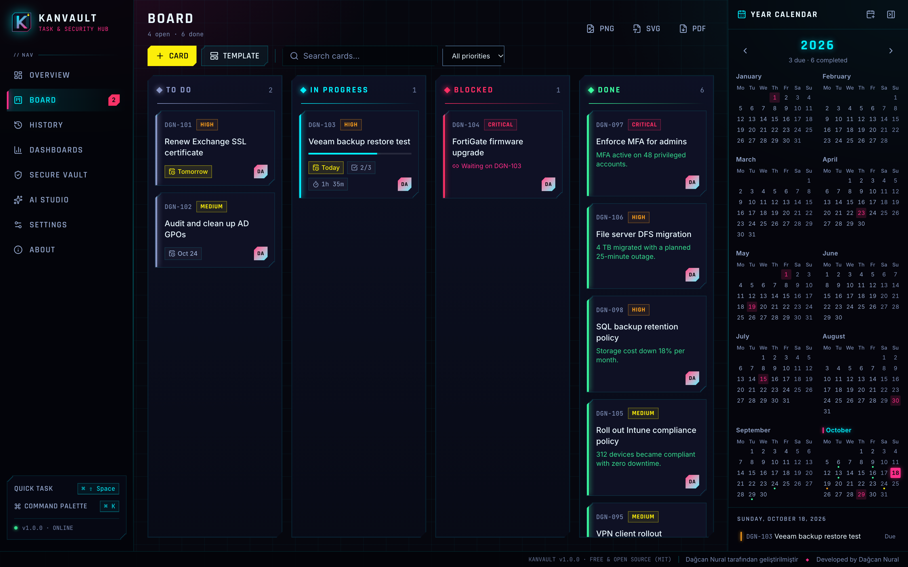
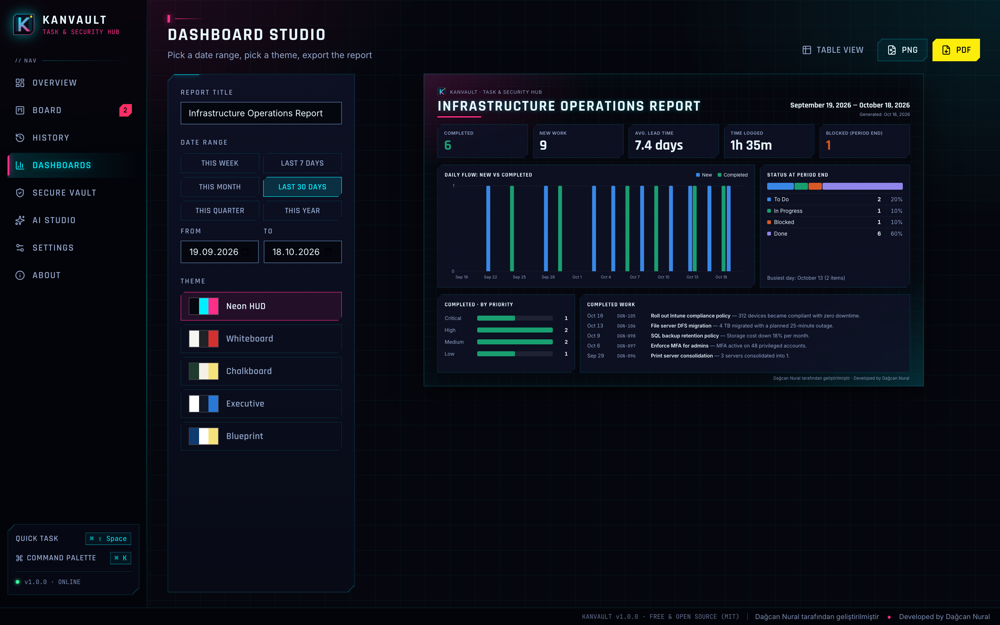
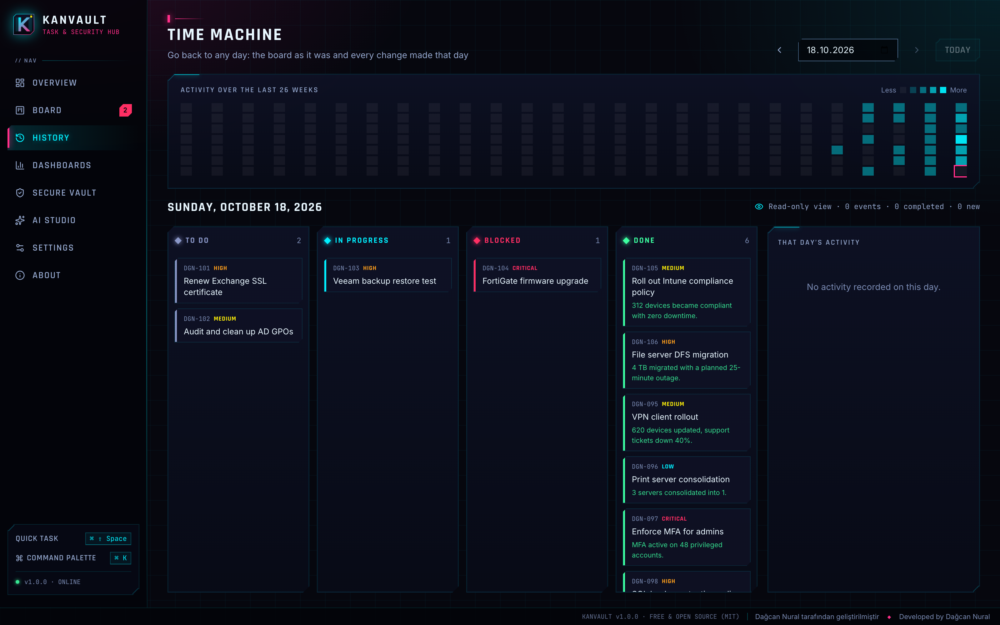

<p align="center">
  
</p>

<h1 align="center">Kanvault</h1>
<p align="center"><b>Task & Security Hub for IT teams — free and open source</b><br/>
Neon Kanban board · Time Machine history · Dashboard Studio · zero-knowledge vault · AI reporting<br/>
Windows & macOS · English & Türkçe</p>

<p align="center">
  <a href="README.tr.md">🇹🇷 Türkçe</a> ·
  <a href="https://github.com/dagcann34/kanvault/releases/latest">Download</a> ·
  <a href="CHANGELOG.md">Changelog</a> ·
  <a href="SECURITY.md">Security</a>
</p>

<p align="center">
  
  
  
  
</p>

<p align="center"></p>

> **Developed by Dağcan Nural.** Kanvault is completely free: no ads, no subscriptions, no telemetry.

## Why Kanvault

Sysadmins juggle tickets, PowerShell snippets, server passwords and status emails across many tools. Kanvault puts the work board, an encrypted vault, a full history of your work and an AI writing assistant into one fast, local-first desktop app. Your data never leaves your machine unless you export it.

## Features

| | |
|---|---|
| **Fixed Kanban board** | Four columns that always fit the window — no accidental dragging; move cards with ◀ ▶ or `Alt + ←/→`; priorities, due dates, dependencies, checklists, time tracking |
| **Time Machine** | Every change is recorded. Pick any past day to see the board exactly as it was and that day’s activity timeline; 26-week activity heatmap |
| **Dashboard Studio** | Choose a date range (this week, last 30 days, quarter, year or custom) and a theme — **Neon HUD, Whiteboard, Chalkboard, Executive, Blueprint** — then export PNG/PDF |
| **Year calendar** | Due dates, completions, overdue days and public holidays at a glance; export to Apple Calendar / Outlook (.ics) |
| **Recurring tasks & templates** | Daily → yearly repeats; templates for patching, certificate renewal, backup tests, onboarding/offboarding and access reviews |
| **Zero-knowledge vault** | Passwords, servers, PowerShell scripts, notes and API keys — Argon2id + AES-256-GCM in Rust, auto-lock, 30-second clipboard clearing, password generator |
| **AI Studio (Claude)** | Executive summary email, STAR CV/LinkedIn bullets, ITIL change request, blameless post-incident report — sensitive data masked locally first |
| **Data protection** | Board and history encrypted at rest (key in the OS keychain), screenshot/recording protection, no text selection or copying of interface data |
| **Everyday flow** | `⌘K` / `Ctrl+K` command palette, menu-bar/tray app, `⌘⇧Space` quick capture, native notifications, launch at login |
| **Bilingual** | Full English and Turkish UI, plus an in-app About page in both languages |

<p align="center">
  
  
</p>

## Download

Get the latest `.dmg` (macOS, Apple Silicon & Intel) or `.exe` / `.msi` (Windows) from **[Releases](https://github.com/dagcann34/kanvault/releases/latest)**.

> Builds are not code-signed yet. On macOS right-click → **Open** the first time; on Windows choose **More info → Run anyway** in SmartScreen.

## Build from source

Requirements: Node.js 20+, Rust (stable); on Windows also the WebView2 runtime and MSVC build tools.

```bash
git clone https://github.com/dagcann34/kanvault.git
cd kanvault
npm install
npm run tauri dev      # desktop app with hot reload
npm run tauri build    # installers in src-tauri/target/release/bundle
cd src-tauri && cargo test
```

## Security model

| Topic | Implementation |
|---|---|
| Vault | Argon2id (m = 64 MiB, t = 3, p = 4) → KEK wraps a random DEK; AES-256-GCM per item with the item id as AAD |
| Board & history | AES-256-GCM; random key stored in macOS Keychain / Windows Credential Manager. A copied file is unreadable without the key (Kerckhoffs’s principle) |
| Brute force | Exponential back-off after repeated wrong master passwords |
| Memory | Keys and decrypted payloads are zeroized on drop |
| Web view | Strict CSP, frozen prototypes, no remote content; each window may only call the commands it needs |
| Interface | Content protection against screenshots and screen recording; selection, copy, context menu and printing blocked outside input fields |

Report vulnerabilities privately — see [SECURITY.md](SECURITY.md).

## Architecture

```
src/                     React 19 + TypeScript + Tailwind v4
├── features/board       Fixed Kanban, templates, recurrence, encrypted store
├── features/history     Event log + Time Machine
├── features/dashboard   Metrics, themes, Dashboard Studio
├── features/vault       Vault UI (crypto lives in Rust)
├── features/ai          Prompt templates, redaction
└── features/about       Bilingual product information
src-tauri/src            Rust core (Tauri v2)
├── crypto.rs            Argon2id + AES-256-GCM
├── vault.rs             Encrypted vault, auto-lock, back-off
├── board.rs             Encrypted board, OS keychain key
└── lib.rs               Tray, shortcuts, content protection
```

## License

[MIT](LICENSE) — free for personal and commercial use.<br/>
**Developed by Dağcan Nural.**
