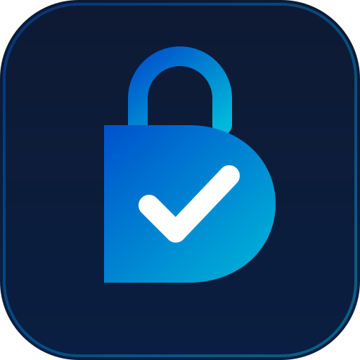
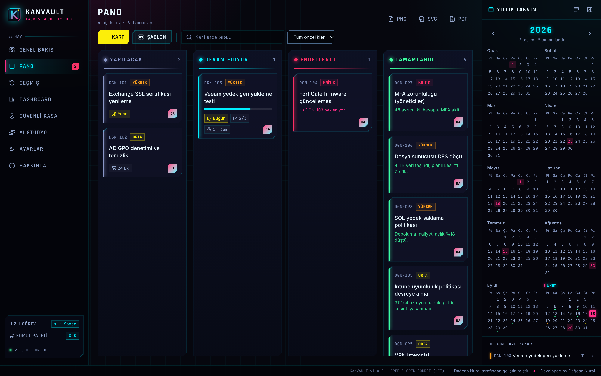
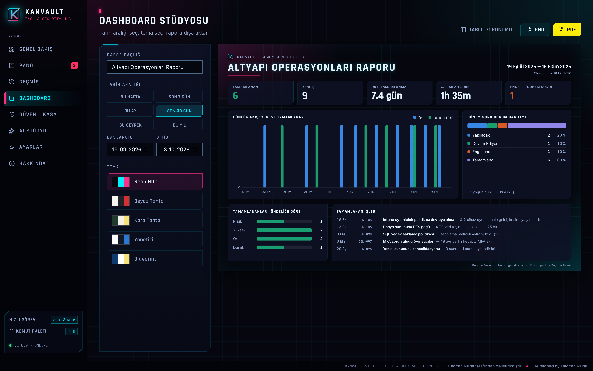
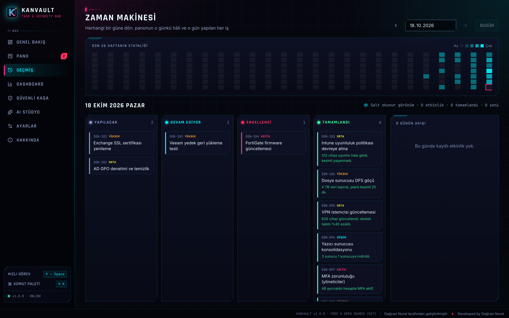

<p align="center">
  
</p>

<h1 align="center">Kanvault</h1>
<p align="center"><b>BT ekipleri için iş ve güvenlik merkezi — ücretsiz ve açık kaynak</b><br/>
Neon Kanban pano · Zaman Makinesi · Dashboard Stüdyosu · sıfır bilgi kasa · AI raporlama<br/>
Windows ve macOS · Türkçe ve English</p>

<p align="center">
  <a href="README.md">🇬🇧 English</a> ·
  <a href="https://github.com/dagcann34/kanvault/releases/latest">İndir</a> ·
  <a href="CHANGELOG.md">Sürüm notları</a> ·
  <a href="SECURITY.md">Güvenlik</a>
</p>

<p align="center"></p>

> **Dağcan Nural tarafından geliştirilmiştir.** Kanvault tamamen ücretsizdir: reklam, abonelik veya veri toplama yoktur.

## Neden Kanvault?

Sistem yöneticileri iş kayıtlarını, PowerShell betiklerini, sunucu parolalarını ve durum e-postalarını birçok araçta yönetiyor. Kanvault; iş panosunu, şifreli kasayı, yaptığın işlerin tam geçmişini ve AI yazım asistanını hızlı, yerel öncelikli tek bir masaüstü uygulamasında birleştirir. Siz dışa aktarmadıkça verileriniz cihazdan çıkmaz.

## Özellikler

| | |
|---|---|
| **Sabit Kanban pano** | Pencereye her zaman tam oturan dört sütun; kazara sürükleme yok. Kartlar ◀ ▶ veya `Alt + ←/→` ile taşınır. Öncelik, son tarih, bağımlılık, kontrol listesi ve süre takibi |
| **Zaman Makinesi** | Her değişiklik kaydedilir. Geçmişteki herhangi bir günü seçip panonun o günkü hâlini ve o günün etkinlik akışını gör; 26 haftalık etkinlik ısı haritası |
| **Dashboard Stüdyosu** | Tarih aralığı seç (bu hafta, son 30 gün, çeyrek, yıl veya özel), tema seç: **Neon HUD, Beyaz Tahta, Kara Tahta, Yönetici, Blueprint**. PNG/PDF olarak dışa aktar |
| **Yıllık takvim** | Teslim, tamamlanma, gecikme günleri ve resmi tatiller tek bakışta; Apple Takvim / Outlook'a aktarma (.ics) |
| **Tekrarlayan görevler ve şablonlar** | Günlükten yıllığa tekrar; yama, sertifika yenileme, yedek testi, işe giriş/çıkış ve yetki gözden geçirme şablonları |
| **Sıfır bilgi kasa** | Parola, sunucu, PowerShell betiği, not ve API anahtarları Rust tarafında Argon2id + AES-256-GCM ile şifrelenir. Otomatik kilit, 30 saniyelik pano temizleme ve parola üretici var |
| **AI Stüdyo (Claude)** | Yönetici özeti e-postası, STAR CV/LinkedIn maddeleri, ITIL değişiklik talebi ve suçlamasız olay raporu üretir; hassas veriler önce cihazda maskelenir |
| **Veri koruma** | Pano ve geçmiş diskte şifreli tutulur (anahtar işletim sistemi anahtar zincirinde). Ekran görüntüsü ve kayıt koruması var; arayüz verisi seçilemez ve kopyalanamaz |
| **Günlük kullanım** | `⌘K` / `Ctrl+K` komut paleti, menü çubuğu/tepside çalışma, `⌘⇧Space` hızlı görev, yerel bildirimler, oturum açınca başlatma |
| **Çift dil** | Arayüz tamamen Türkçe ve İngilizce; uygulama içinde iki dilli Hakkında sayfası da var |

<p align="center">
  
  
</p>

## İndir

En güncel `.dmg` (macOS, Apple Silicon ve Intel) veya `.exe` / `.msi` (Windows) dosyasını **[Releases](https://github.com/dagcann34/kanvault/releases/latest)** sayfasından indir.

> Sürümler henüz kod imzalı değil. macOS'ta ilk açılışta sağ tık → **Aç**; Windows'ta SmartScreen'de **Ek bilgi → Yine de çalıştır**.

## Kaynaktan derleme

Gereksinimler: Node.js 20+, Rust (stable); Windows'ta ayrıca WebView2 ve MSVC derleme araçları.

```bash
git clone https://github.com/dagcann34/kanvault.git
cd kanvault
npm install
npm run tauri dev
npm run tauri build
cd src-tauri && cargo test
```

## Güvenlik modeli

| Konu | Uygulama |
|---|---|
| Kasa | Argon2id (m = 64 MiB, t = 3, p = 4) → KEK rastgele bir DEK'i sarar; her kayıt AES-256-GCM ile, kayıt kimliği AAD olarak bağlı |
| Pano ve geçmiş | AES-256-GCM; rastgele anahtar macOS Anahtar Zinciri / Windows Kimlik Bilgisi Yöneticisi'nde. Dosya kopyalansa da anahtar olmadan okunamaz (Kerckhoffs ilkesi) |
| Kaba kuvvet | Hatalı ana parola denemelerinden sonra üstel bekleme |
| Bellek | Anahtarlar ve çözülmüş içerik bellekten silinirken sıfırlanır |
| Arayüz motoru | Sıkı CSP, dondurulmuş prototipler, uzak içerik yok; her pencere yalnızca ihtiyaç duyduğu komutları çağırabilir |
| Arayüz | Ekran görüntüsü ve kayıt koruması; giriş alanları dışında seçme, kopyalama, sağ tık ve yazdırma kapalı |

Güvenlik açıklarını özel olarak bildir: [SECURITY.md](SECURITY.md).

## Lisans

[MIT](LICENSE): kişisel ve ticari kullanım için ücretsiz.<br/>
**Dağcan Nural tarafından geliştirilmiştir.**
